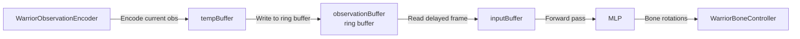

# Requirements

### Overview & Goals
Implement a frame-delayed observation buffer so each warrior's MLP reacts to where the opponent **was** N frames ago instead of the current frame. This breaks the synchronous symmetry that causes convergent, predictable behavior and introduces delayed-feedback dynamics similar to real combat.

### Scope
**In Scope:**
- Add a circular observation buffer to store past opponent observations
- Feed delayed observations (N frames old) to the MLP instead of current ones
- Configurable delay (default N=2, easily adjustable)

**Out of Scope:**
- Changing the MLP architecture
- Modifying the genetic evolution algorithm
- Changing time signal phases between warriors

### User Stories
- As a developer, I want to configure the observation delay so I can experiment with different delay values (1–5 frames) to find the most interesting behavior.
- As an observer, I expect warriors to exhibit more varied, oscillatory, and anticipatory behavior instead of converging to identical synchronized poses.

### Functional Requirements
- Each warrior maintains a ring buffer of past observations
- The MLP receives observations from N frames ago (default N=2)
- During the first N frames of a round, the buffer is filled with zeros
- The delay is configurable via a serialized field on WarriorAgent

### Non-Functional Requirements
- Zero allocations during inference — the buffer must be pre-allocated in Awake()
- Minimal performance overhead — index-based ring buffer, not Queue
- The buffer size must match the observation dimension exactly

# Technical Design

### Current Implementation
The movement pipeline in `WarriorAgent.FixedUpdate()` (line 95-107) is fully synchronous:
1. `observationEncoder.Encode(inputBuffer)` — encodes **current** opponent bone positions, root data, self bones, and time signals
2. `neuralNetwork.Forward(inputBuffer, outputBuffer)` — runs MLP inference
3. `boneController.ApplyOutputs(outputBuffer)` — applies bone rotations

Both warriors execute this in the same `FixedUpdate` tick. `WarriorObservationEncoder.Encode()` reads the opponent's current transform state directly and uses shared `Time.time` for signals. This produces identical inputs → identical strategies → convergence.

### Key Decisions
**Ring buffer in WarriorAgent, not in the encoder.** The encoder (`WarriorObservationEncoder`) is a pure observation capture component — it reads the world state. The delay is a decision about what information the MLP receives, which belongs in the agent (`WarriorAgent`) that orchestrates the pipeline. This keeps the encoder's responsibility clean and requires zero changes to it.

**Index-based ring buffer, not Queue<float[].** Pre-allocate `float[bufferDepth * inputDim]` and track a write index with modulo arithmetic. Zero allocations, better cache locality than an array of arrays.

**Delay the entire observation vector.** For simplicity, the full observation vector (opponent + self + time) is delayed. This is cleaner than splitting the vector and achieves the same goal: the MLP sees a delayed version of the world.

### Proposed Changes

**WarriorAgent.cs** modifications:
- Add `[SerializeField] int observationDelay = 2` — configurable delay in frames
- Add `float[] observationBuffer` — ring buffer pre-allocated in Awake(), size `observationDelay * inputDim`
- Add `int writeIndex` — current write position in ring buffer
- Add `float[] tempBuffer` — temporary capture buffer, size `inputDim`

**Modified FixedUpdate pipeline:**
```
// 1. Encode current observations into temp buffer
observationEncoder.Encode(tempBuffer);

// 2. Store current observations into ring buffer
int writePos = writeIndex % observationDelay;
Array.Copy(tempBuffer, 0, observationBuffer, writePos * inputDim, inputDim);

// 3. Read delayed observations into input buffer
int readPos = ((writeIndex - observationDelay) % observationDelay + observationDelay) % observationDelay;
Array.Copy(observationBuffer, readPos * inputDim, inputBuffer, 0, inputDim);

// 4. Run inference on delayed observations
neuralNetwork.Forward(inputBuffer, outputBuffer);

// 5. Apply bone rotations
boneController.ApplyOutputs(outputBuffer);

writeIndex++;
```

**ResetRound()** must clear the buffer and reset writeIndex to 0.

**WarriorObservationEncoder.cs** — No changes. The encoder continues to capture current observations.
**WarriorBoneController.cs** — No changes.

### Risks
- **Warmup period:** First N frames have stale buffer data. Mitigated by filling buffer with zeros in ResetRound().
- **Modulo arithmetic:** C# `%` can return negative for negative operands. Must use `((writeIndex - delay) % delay + delay) % delay`.
- **Performance:** Two Array.Copy per frame for ~200 floats is negligible.

### Architecture Diagram


The ring buffer sits between the encoder and the MLP, introducing N frames of delay. Each warrior has its own independent buffer.

# Testing

### Validation Approach
Verify by running the Unity simulation and observing warrior behavior with different delay values.

### Key Scenarios
- **Delay=0:** Warriors behave identically to current implementation (regression check)
- **Delay=2 (default):** Noticeable oscillation and varied behavior
- **Delay=1 and delay=5:** Confirm the parameter is adjustable and produces expected effects

### Edge Cases
- **First frames of a round:** Buffer is empty, should feed zeros for opponent data
- **ResetRound():** Buffer must be cleared, writeIndex reset to 0
- **Buffer index wraparound:** After many frames, modulo arithmetic must correctly cycle
- **Single warrior scenario:** If opponent is null, delay still works (encoder fills zeros)

### Test Changes
No automated tests exist in the project. Validation is through visual observation in the Unity editor during simulation runs.

# Delivery Steps

###   Step 1: Add observation delay buffer to WarriorAgent
Implement the ring buffer and delayed observation reading in WarriorAgent.FixedUpdate().

- Add `observationDelay` serialized field (default 2) to WarriorAgent.cs
- Add ring buffer `float[] observationBuffer` pre-allocated in Awake(), sized at `observationDelay * inputDim`
- Add `writeIndex` field and `tempBuffer` for current-frame capture
- Modify FixedUpdate() to: encode to tempBuffer → write to ring buffer → read delayed frame → forward through MLP
- Modify ResetRound() to clear buffer and reset writeIndex
- Handle modulo arithmetic for negative indices: `((writeIndex - delay) % delay + delay) % delay`
- Pre-allocate tempBuffer in Awake() to avoid per-frame allocations

###   Step 2: Verify delayed observations in Unity simulation
Run the simulation with different delay values to confirm correct behavior.

- Test delay=0 to verify regression-free behavior (identical to current implementation)
- Test delay=2 (default) to observe oscillatory, varied behavior
- Test delay=1 and delay=5 to confirm the parameter is adjustable
- Verify first frames of each round produce zeros for opponent data
- Confirm zero allocations during inference by checking Unity profiler