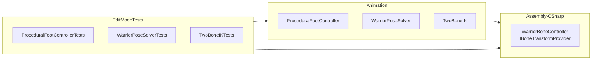

# Root Cause

### What's Happening

The edit-mode tests reference three types (`IBoneTransformProvider`, `ProceduralFootController`, `WarriorPoseSolver`) that don't exist in the `EditModeTests` assembly. The tests' `.asmdef` references `Assembly-CSharp`, expecting these types to be there.

### Why It Fails

The source files for `ProceduralFootController`, `WarriorPoseSolver`, and `TwoBoneIK` live in `Assets/Components/Animation/` — a folder created recently without its own `.asmdef`. By default, files without an `.asmdef` should compile into `Assembly-CSharp`. However, Unity hasn't regenerated the `Assembly-CSharp.csproj` to include these new files. The `.csproj` is stale.

The `IBoneTransformProvider` interface (defined in `WarriorBoneController.cs`, `Assets/Components/Warrior/`) IS included in the `.csproj` and compiles fine — it's just the Animation folder files that are missing.

### Why Not Patch the .csproj

The `.csproj` files are Unity-generated, gitignored (`*.csproj` in `.gitignore`), and will be overwritten by Unity on next regeneration. Patching them is a temporary workaround, not a fix.

# Technical Design

### Current State

| File | Location | Assembly | In .csproj? |
|---|---|---|---|
| `WarriorBoneController.cs` (defines `IBoneTransformProvider`) | `Assets/Components/Warrior/` | Assembly-CSharp | ✅ Yes |
| `ProceduralFootController.cs` | `Assets/Components/Animation/` | Assembly-CSharp (default) | ❌ No |
| `WarriorPoseSolver.cs` | `Assets/Components/Animation/` | Assembly-CSharp (default) | ❌ No |
| `TwoBoneIK.cs` | `Assets/Components/Animation/` | Assembly-CSharp (default) | ❌ No |
| `EditModeTests.asmdef` | `Assets/Tests/EditMode/` | EditModeTests | N/A |

### Key Decision: Create Dedicated Animation Assembly Definition

Instead of relying on Unity's default assembly (which has been unreliable for these new files), create a dedicated `.asmdef` for the Animation folder. This gives Unity explicit control and eliminates the "stale .csproj" problem entirely.

**Why this approach:**
- `.asmdef` files are NOT Unity-generated — they persist across regenerations
- Unity's assembly system resolves `.asmdef` references reliably
- The test `.asmdef` can explicitly reference the new Animation assembly
- No more dependency on Unity regenerating the default `.csproj` correctly

### Proposed Changes

1. **Create `Assets/Components/Animation/Animation.asmdef`** — a new assembly definition named `Animation` covering the three source files in that folder.

2. **Update `Assets/Tests/EditMode/EditModeTests.asmdef`** — add `Animation` to its `references` array alongside the existing `Assembly-CSharp` reference.

This ensures the test assembly can always resolve `ProceduralFootController`, `WarriorPoseSolver`, `TwoBoneIK`, and `IBoneTransformProvider` (via the `Assembly-CSharp` reference which already works).

### Architecture

# Delivery Steps

### ✓ Step 1: Create Animation assembly definition
Create `Assets/Components/Animation/Animation.asmdef` with name `Animation`, referencing `Assembly-CSharp` (for `IBoneTransformProvider`), and targeting Editor platform. This ensures the three Animation source files compile into their own assembly.

### ✓ Step 2: Update EditModeTests assembly definition to reference Animation
Edit `Assets/Tests/EditMode/EditModeTests.asmdef` to add `Animation` to the `references` array alongside the existing `Assembly-CSharp` and `UnityEditor.TestRunner` references. After this, the test assembly can resolve all three missing types.