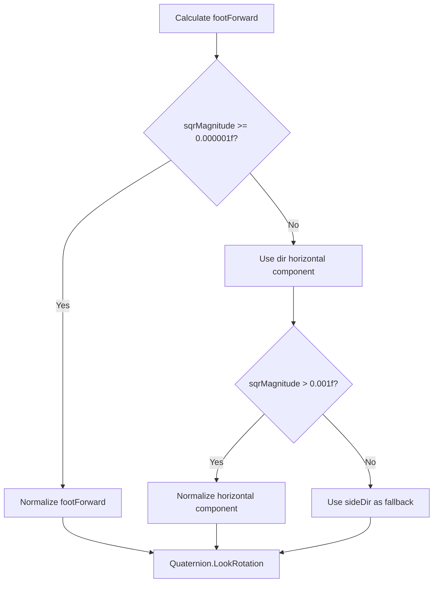

# Requirements

### Overview & Goals

Fix the foot orientation logic in `TwoBoneIK.cs` to ensure warrior feet always point down with soles facing the ground, regardless of foot position or character orientation. The current implementation has a degenerate case handling bug where normalization is called before checking if the vector has sufficient magnitude.

### Scope

**In Scope:**
- Fix the `footForward` normalization logic in `TwoBoneIK.cs` (lines 273-284)
- Ensure proper fallback chain when `footForward` is too small
- Maintain existing behavior for non-degenerate cases

**Out of Scope:**
- Changes to the IK solver algorithm itself
- Changes to the knee bending logic
- Changes to the foot controller state machine

### User Stories

- As a developer, I want warrior feet to always point down with soles facing the ground so that warriors appear correctly planted on the arena floor
- As a developer, I want the foot orientation to handle degenerate cases (forward parallel to sole direction) gracefully so that warriors don't exhibit strange rotation artifacts

### Functional Requirements

1. **Foot Sole Faces Ground**: The foot sole must always face downward (negative dot product with `Vector3.up`)
2. **Degenerate Handling**: When `footForward` is too small to normalize, use the horizontal component of `dir` as fallback
3. **Fallback Chain**: If horizontal component is insufficient, use `sideDir` as last resort
4. **No Normalization of Zero Vectors**: Only normalize `footForward` when magnitude is sufficient (> 0.000001)

### Non-Functional Requirements

- Maintain numerical stability (avoid NaN/Infinity)
- Preserve existing performance characteristics
- No breaking changes to the public API

# Technical Design

### Current Implementation

The foot rotation logic in `TwoBoneIK.cs` (lines 248-300) has a bug in the degenerate case handling:

```csharp
// Project character forward onto the plane perpendicular to soleDir
Vector3 footForward = rootTransform.forward - soleDir * Vector3.Dot(rootTransform.forward, soleDir);
footForward.Normalize();  // BUG: Normalize called before checking magnitude
if (footForward.sqrMagnitude < 0.000001f)
{
    // Fallback logic
}
```

The `Normalize()` call on line 275 happens before checking if the magnitude is sufficient, which can lead to numerical instability.

### Key Decisions

1. **Check magnitude before normalization**: Only call `Normalize()` when `sqrMagnitude >= 0.000001f`
2. **Fallback chain**: When `footForward` is too small:
   - First try: Use horizontal component of `dir` (ignoring Y component)
   - Second try: Use `sideDir` as last resort
3. **Maintain sole direction logic**: Keep the existing logic that ensures `soleDir` always points down (lines 258-271)

### Proposed Changes

Fix the degenerate case handling in `TwoBoneIK.cs` lines 273-284:

1. Remove the premature `Normalize()` call
2. Check magnitude first
3. Only normalize when magnitude is sufficient
4. Use proper fallback chain for degenerate cases

### Data Models / Contracts

No changes to data models. The fix only affects the internal calculation of `footForward` in the `TwoBoneIK.Solve()` method.

### Components

- **TwoBoneIK.cs**: Fix the foot orientation degenerate handling (lines 273-284)

### File Structure

- **Modified**: `Assets/Components/Warrior/TwoBoneIK.cs` (lines 273-284)

### Architecture Diagram



### Risks

- **Low Risk**: This is a localized fix to degenerate case handling
- **Mitigation**: Existing tests in `FootOnFloorTests.cs` will verify the fix works correctly

# Delivery Steps

### * Step 1: Fix footForward normalization logic
Fix footForward normalization in TwoBoneIK.cs

- Remove the premature footForward.Normalize() call on line 275
- Check footForward.sqrMagnitude >= 0.000001f BEFORE normalizing
- Only call Normalize() when magnitude is sufficient
- Maintain the fallback chain: dirHorizontal → sideDir