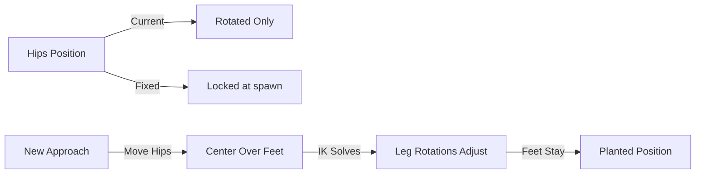

# Requirements

### Overview & Goals

Fix the character animation so that hips are positioned directly over the feet (within the balance area) rather than being positioned far outside the foot base. The feet should remain in their current positions before and after the adjustment.

### Scope

**In Scope:**
- Modify `WarriorPoseSolver.Solve()` to move hips horizontally to center them over the foot midpoint when CoM is unbalanced
- Adjust the leg IK to accommodate the new hip position while keeping feet planted
- Ensure the change works with the existing two-bone IK system

**Out of Scope:**
- Changing the foot positioning logic
- Modifying the balance threshold or step triggering logic
- Changing joint limits or rotation behavior

### User Stories

- As a developer, I want hips to be positioned over the feet so that the character appears balanced and stable
- As a developer, I want feet to remain in their planted positions when hips are repositioned so that the animation looks natural

### Functional Requirements

1. When the center of mass (hips) is offset from the foot midpoint beyond the balance threshold, the system should:
   - Calculate the horizontal offset needed to center hips over feet
   - Move hips horizontally toward the foot midpoint
   - Adjust leg rotations via IK to maintain foot positions
   - Keep feet at their current planted positions

2. The hip movement should be limited to keep hips within a reasonable distance over the feet (e.g., within the foot base)

### Non-Functional Requirements

- Maintain compatibility with existing two-bone IK solver
- Preserve the existing balance threshold and step triggering behavior
- No changes to bone rotation limits or joint constraints

# Technical Design

### Current Implementation

**WarriorPoseSolver.cs** (lines 142-183):
- Evaluates balance by computing CoM offset from foot midpoint
- When offset exceeds `balanceThreshold` (0.25m), it rotates hips/spine/chest to lean the upper body
- Hips position is locked by `WarriorBoneController` (line 164: `transform.position = spawnPosition`)
- This rotation-only approach doesn't actually move hips over the feet

**TwoBoneIK.cs:**
- Solves leg IK given hip (root) position and foot target positions
- Modifies upper leg and lower leg rotations to reach foot targets
- Does not modify hip position directly

### Key Decisions

1. **Move hips horizontally, not just rotate**: Instead of only rotating hips to lean the body, we will actually move the hips position horizontally toward the foot midpoint to center them over the balance area.

2. **Limit hip movement range**: Hips should only move within a reasonable range over the feet (e.g., to the midpoint between feet) to avoid unnatural positioning.

3. **IK will automatically adjust**: Since TwoBoneIK uses the hip position as the starting point for solving leg rotations, moving the hips will naturally cause the IK to adjust leg rotations to keep feet planted.

### Proposed Changes

**WarriorPoseSolver.cs** - Modify the balance correction logic (lines 142-183):

1. Calculate the horizontal offset needed to center hips over foot midpoint
2. Move hips horizontally toward the foot midpoint (but not past it)
3. Keep the Y position unchanged (hips stay at same height)
4. The existing IK code will automatically adjust leg rotations to accommodate the new hip position

**Key change**: Replace the rotation-only approach with a position-based approach that actually moves hips over the feet.

### Data Models / Contracts

No new data models. The change is purely in the `Solve()` method logic.

### Components

- **WarriorPoseSolver**: Balance correction logic modified to move hips horizontally
- **TwoBoneIK**: No changes needed - automatically responds to hip position changes
- **WarriorBoneController**: No changes needed - hip position will be updated by pose solver before bone controller locks it

### Architecture Diagram

### Risks

- Moving hips might cause the upper body to appear disconnected from legs if not handled carefully
- The `WarriorBoneController` locks hip position, so we need to ensure the move happens before the lock is applied
- Need to verify that the IK solver can handle the new hip positions without issues

# Delivery Steps

### * Step 1: modify-hip-balance-correction
Modify WarriorPoseSolver balance correction to move hips horizontally over feet

- Update the balance correction logic in WarriorPoseSolver.Solve() (lines 142-183)
- Calculate horizontal offset needed to center hips over foot midpoint
- Move hips position horizontally toward the foot midpoint (but not past it)
- Keep Y position unchanged to maintain height
- The existing TwoBoneIK will automatically adjust leg rotations to keep feet planted

- File: /Users/jeffreykesselman/Documents/projects/EvolvingWarriors 2/Assets/Components/Warrior/WarriorPoseSolver.cs

###   Step 2: verify-fix-with-tests
Verify the fix works correctly with existing tests

- Run WarriorPoseSolverTests to ensure balance tests still pass
- Verify that feet remain at their planted positions after hip movement
- Check that leg IK correctly adjusts to the new hip positions

- Test file: /Users/jeffreykesselman/Documents/projects/EvolvingWarriors 2/Assets/Editor/WarriorPoseSolverTests.cs